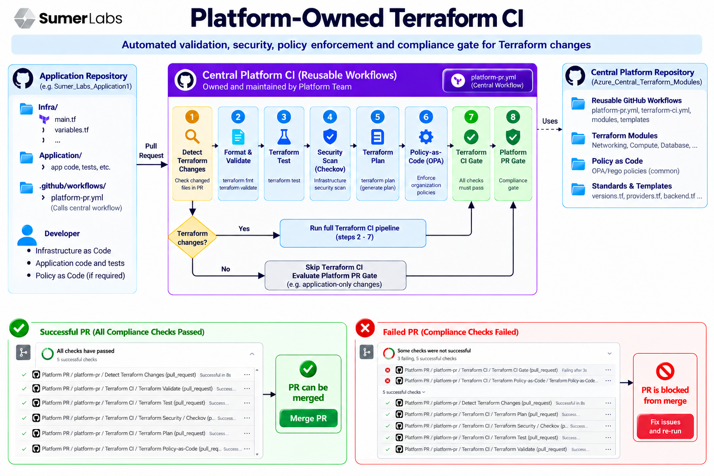

# Azure Central Terraform Modules

**Platform-Owned Terraform CI | Azure Infrastructure | Policy as Code | GitHub Actions**

A centralized platform repository for reusable Azure Terraform modules, shared infrastructure governance policies, and standardized Terraform configuration and CI practices.

---

## Table of Contents

- [Overview](#overview)
- [Objectives](#objectives)
- [Architecture](#architecture)
- [Architecture Explained](#architecture-explained)
- [Repository Structure](#repository-structure)
- [Central Terraform Modules](#central-terraform-modules)
- [Central Policy as Code](#central-policy-as-code)
- [Platform Terraform Configuration](#platform-terraform-configuration)
- [Platform Release Management](#platform-release-management)
- [Terraform CI Workflow](#terraform-ci-workflow)
- [Azure Authentication and Access Control](#azure-authentication-and-access-control)
- [Application Repository Integration](#application-repository-integration)
- [Pull Request Workflow](#pull-request-workflow)
- [Security Principles](#security-principles)
- [Ownership and Responsibilities](#ownership-and-responsibilities)
- [Scope and Limitations](#scope-and-limitations)
- [Related Repository](#related-repository)

---

## Overview

This repository establishes a platform-owned approach to Infrastructure as Code (IaC) for Microsoft Azure.

The platform centralizes reusable Terraform infrastructure modules, common infrastructure policies, Terraform configuration standards, and platform release metadata.

Application repositories consume these shared capabilities instead of independently duplicating infrastructure implementations and governance rules.

The objective is to improve consistency, maintainability, security, and governance across application infrastructure.

### Core Capabilities

- **Central Terraform modules:** Reusable Azure infrastructure components maintained by the platform team.
- **Central Policy as Code:** Shared Rego policies for infrastructure governance.
- **Platform Terraform configuration:** Common Terraform version, provider, and backend configuration.
- **Release management:** Versioned platform release metadata.
- **CI integration:** Support for standardized Terraform validation and policy evaluation through the platform's configured GitHub Actions workflows.
- **Secure Azure access:** Support for GitHub Actions OIDC authentication where configured.

## Objectives

The platform aims to:

1. Reduce duplicated Terraform code across application repositories.
2. Establish consistent Azure infrastructure implementation patterns.
3. Maintain common Terraform and provider configuration centrally.
4. Define shared infrastructure governance policies.
5. Integrate policy evaluation into infrastructure CI.
6. Support controlled and traceable platform releases.
7. Enable application teams to consume approved infrastructure capabilities.
8. Encourage secure authentication and least-privilege Azure access.

## Architecture

The platform separates centrally managed infrastructure capabilities from application-specific Terraform configuration.



*Architecture diagram illustrating the relationship between application repositories, central Terraform modules, platform configuration, policy evaluation, and CI controls.*

### High-Level Flow

```text
Application Repository
        |
        | Infrastructure Change / Pull Request
        v
Platform-Owned Terraform CI
        |
        +--> Terraform Setup and Initialization
        |
        +--> Format and Validate
        |
        +--> Terraform Tests
        |
        +--> Security Scanning, Where Configured
        |
        +--> Terraform Plan
        |
        +--> OPA Policy Evaluation
        |
        v
Configured CI Checks
        |
        v
Pull Request Review
```

The exact workflow stages and their enforcement depend on the implemented GitHub Actions configuration.

## Architecture Explained

### 1. Application Repository

The application repository contains application-specific Terraform configuration and environment inputs.

Application teams define the infrastructure they require and submit changes through pull requests. They consume shared platform capabilities rather than maintaining independent copies of common infrastructure implementations.

### 2. Central Terraform Modules

The platform repository provides reusable Terraform modules for supported Azure infrastructure components.

These modules establish common interfaces for infrastructure resources, configurable inputs, and outputs.

### 3. Central Policy as Code

The platform maintains common infrastructure governance rules in Rego.

The current repository structure includes a required-tags policy at:

`Policy As code/terraform/common/required_tags.rego`

The policy can be evaluated through OPA when the CI workflow supplies the expected input and invokes the appropriate policy evaluation.

### 4. Platform Terraform Configuration

The platform maintains common Terraform configuration files under `platform/terraform/`.

These files cover Terraform version constraints, provider configuration, and backend conventions.

### 5. Terraform CI

The platform's configured GitHub Actions workflows can coordinate Terraform validation, tests, security checks, planning, and policy evaluation.

The actual workflow implementation determines which stages run and how their results affect the pull request.

### 6. Pull Request Controls

CI results support infrastructure review. Repository rules can require selected checks to pass before a pull request is eligible for merging.

A successful CI run does not by itself mean that infrastructure has been deployed.

---

## Repository Structure

The repository separates infrastructure modules, policy definitions, platform configuration, release metadata, and GitHub automation.

### Current Repository Layout

```text
Azure_Central_Terraform_Modules/
├── .github/
├── Infra/
│   └── networking/
│       └── vnet/
│           ├── tests/
│           ├── main.tf
│           ├── outputs.tf
│           └── variables.tf
├── Policy As code/
│   └── terraform/
│       └── common/
│           └── required_tags.rego
├── platform/
│   ├── releases/
│   │   └── 1.0.0/
│   │       └── release.yaml
│   └── terraform/
│       ├── backend.tf
│       ├── providers.tf
│       └── versions.tf
└── CHANGELOG.md
```

This layout reflects the repository structure currently identified. Additional files may exist inside `.github/` or other directories.

### Directory Responsibilities

| Path | Responsibility |
|---|---|
| `.github/` | GitHub automation and repository configuration |
| `Infra/networking/vnet/` | Terraform implementation for the Virtual Network module |
| `Infra/networking/vnet/tests/` | Tests associated with the Virtual Network module |
| `Policy As code/terraform/common/` | Shared Terraform-related policy definitions |
| `platform/terraform/` | Terraform, provider, and backend configuration |
| `platform/releases/1.0.0/` | Metadata for platform release `1.0.0` |
| `CHANGELOG.md` | Repository change history |

## Central Terraform Modules

The `Infra/` directory contains reusable Terraform infrastructure implementations maintained by the platform team.

### Virtual Network Module

Location:

`Infra/networking/vnet/`

The current module contains:

- `main.tf` — Terraform resource definitions.
- `variables.tf` — Configurable module inputs.
- `outputs.tf` — Values exposed to consuming Terraform configurations.
- `tests/` — Module tests.

The Virtual Network module provides a reusable starting point for Azure networking infrastructure.

Its actual supported features, required inputs, outputs, and resource configuration should be documented alongside the module implementation.

### Module Design Principles

- Keep modules focused on a clearly defined infrastructure capability.
- Use descriptive variable names and outputs.
- Validate required inputs and supported values.
- Use secure defaults where appropriate.
- Avoid hardcoding environment-specific values and credentials.
- Test module changes before releasing them.
- Maintain backward compatibility or document breaking changes.
- Keep module documentation aligned with its implementation.

### Consuming a Central Module

Application repositories should reference the central module through an approved source and versioning strategy.

Illustrative example:

```hcl
module "vnet" {
  source = "git::https://github.com/Sumer-Labs/Azure_Central_Terraform_Modules.git//Infra/networking/vnet?ref=v1.0.0"

  # Add the inputs declared by variables.tf.
}
```

This example assumes a `v1.0.0` Git tag exists and that the module supports the supplied configuration. Confirm the actual release reference and module inputs before using it.

---

## Central Policy as Code

The `Policy As code/` directory contains shared infrastructure governance rules.

Central policy ownership allows common requirements to be defined once and evaluated consistently across consuming application repositories.

### Current Policy Structure

```text
Policy As code/
└── terraform/
    └── common/
        └── required_tags.rego
```

### Required Tags Policy

The current policy file is:

`Policy As code/terraform/common/required_tags.rego`

This policy is intended to centralize rules related to required resource tags.

Resource tags can help organizations maintain ownership, environment identification, cost allocation, and resource governance.

The exact required tags and evaluation behavior are determined by the contents of the Rego policy.

### Open Policy Agent

Open Policy Agent (OPA) evaluates structured inputs against policies written in Rego.

The intended policy evaluation flow is:

1. A Terraform change is proposed.
2. The CI workflow prepares the required policy input.
3. OPA evaluates the input against the relevant Rego policy.
4. The workflow interprets the evaluation result.
5. The result is reported through the configured CI checks.

For reliable enforcement, the workflow must explicitly invoke OPA, provide compatible input data, and handle policy failures correctly.

### Policy Ownership

The platform team owns shared policy definitions and their intended behavior.

Application repositories consume the policy controls through the configured CI workflow instead of independently duplicating the same policy implementation.

**Note:** The presence of a Rego file alone does not establish that the policy is currently enforced in CI. Enforcement depends on the workflow integration and configured checks.

---

## Platform Terraform Configuration

The `platform/terraform/` directory contains common Terraform configuration files maintained as part of the platform.

```text
platform/
└── terraform/
    ├── backend.tf
    ├── providers.tf
    └── versions.tf
```

### `versions.tf`

Defines Terraform and provider version constraints.

Central version standards help keep the Terraform toolchain consistent across consuming repositories.

### `providers.tf`

Defines the Terraform provider configuration, including the AzureRM provider where applicable.

Central provider standards help ensure consistent configuration across infrastructure projects.

### `backend.tf`

Defines Terraform backend configuration conventions.

The backend determines how Terraform state is stored and accessed. For Azure deployments, the configuration may use Azure Storage for remote state.

Backend configuration should follow the platform's state naming, authentication, and access-control conventions.

### Configuration Ownership

The platform team maintains common Terraform configuration standards.

Application repositories should consume these standards through the supported workflow or configuration mechanism rather than independently duplicating and modifying platform-owned configuration.

The actual mechanism for supplying these files is determined by the implemented workflow.

---

## Platform Release Management

The repository includes release metadata under:

`platform/releases/`

### Current Release Structure

```text
platform/
└── releases/
    └── 1.0.0/
        └── release.yaml
```

The `release.yaml` file records metadata for release `1.0.0`.

The release directory provides a place to organize platform release information and track changes to shared infrastructure capabilities.

### Release Principles

- Document changes to shared modules and policies.
- Identify breaking changes.
- Maintain compatibility information where appropriate.
- Test module and workflow changes before release.
- Use a consistent versioning strategy for consuming repositories.

The exact release fields, publishing process, and compatibility rules should follow the existing `release.yaml` and the platform's release procedure.

---

## Terraform CI Workflow

The platform is designed to integrate shared infrastructure modules and policies with standardized Terraform CI.

GitHub Actions workflow definitions and automation are maintained under `.github/`.

The exact workflow filenames and inputs should be taken from the actual files in that directory.

### Intended CI Stages

The configured CI process may include:

1. **Checkout:** Retrieve the application infrastructure configuration.
2. **Terraform setup:** Select the approved Terraform version.
3. **Azure authentication:** Authenticate using the configured OIDC trust relationship.
4. **Initialization:** Initialize Terraform and resolve required providers and modules.
5. **Formatting and validation:** Check formatting and validate Terraform configuration.
6. **Testing:** Execute the configured Terraform tests.
7. **Security scanning:** Run configured security checks, such as Checkov if integrated.
8. **Planning:** Generate a Terraform plan for review.
9. **Policy evaluation:** Evaluate applicable policy input using OPA.
10. **CI result:** Report results to the pull request and enforce configured checks.

These are the intended CI capabilities; the actual workflow YAML is the source of truth for what currently runs.

### Policy Integration

To integrate the current required-tags policy into CI, the workflow must:

- Identify the relevant Rego policy.
- Prepare the expected input.
- Run OPA against the policy.
- Interpret the evaluation result.
- Fail the appropriate CI check when an enforced policy requirement is violated.

Policy evaluation should be tested using both compliant and non-compliant examples.

---

## Azure Authentication and Access Control

GitHub Actions OpenID Connect (OIDC) can establish a federated trust relationship between GitHub and Microsoft Entra ID.

When configured correctly, OIDC allows a workflow to authenticate to Azure without storing a long-lived client secret in GitHub for that authentication flow.

### Typical Requirements

- An Entra application or supported federated identity.
- A federated credential matching the intended GitHub identity.
- Appropriate Azure role assignments.
- GitHub Actions token permissions, including `id-token: write`.
- A compatible Azure login step.

### Least Privilege

Azure permissions should be scoped to the resources and operations required by the workflow.

Terraform state access should be considered separately from permissions required to create or modify infrastructure resources.

OIDC reduces reliance on long-lived secrets but does not remove the need to secure federated credentials, workflow permissions, and Azure role assignments.

---

## Application Repository Integration

The central platform is intended to support application repositories that consume shared Terraform capabilities.

Related application repository:

**[Sumer_Labs_Application1](https://github.com/Sumer-Labs/Sumer_Labs_Application1)**

### Platform Responsibilities

- Maintain reusable Terraform modules.
- Define common Terraform and provider standards.
- Maintain central policy definitions.
- Manage platform release metadata.
- Maintain shared CI workflows and supported integration interfaces.

### Application Responsibilities

- Define application-specific infrastructure.
- Supply approved environment-specific inputs.
- Consume approved modules.
- Invoke the configured CI workflow.
- Review Terraform plans and resolve CI findings.

This separation allows the platform team to manage shared capabilities centrally while application teams focus on their infrastructure requirements.

---

## Pull Request Workflow

The intended infrastructure change lifecycle is:

1. A developer modifies application Terraform configuration.
2. A pull request is opened.
3. The configured platform CI workflow runs.
4. Terraform validation and tests execute.
5. Configured security checks run.
6. Terraform generates a plan.
7. OPA evaluates the applicable policy input.
8. CI results are reported.
9. Reviewers assess the infrastructure changes and findings.
10. Repository rules determine whether the required checks have passed.

A successful CI run indicates that the configured checks passed. It does not imply that infrastructure has been deployed.

## Security Principles

The platform follows these intended principles:

- **Central governance:** Maintain shared infrastructure standards and policy definitions centrally.
- **Least privilege:** Grant identities only the access required for their responsibilities.
- **Secure authentication:** Prefer supported federated authentication over long-lived credentials.
- **Policy-driven validation:** Evaluate infrastructure against explicitly defined governance rules.
- **Controlled changes:** Review Terraform plans and require appropriate CI checks.
- **State protection:** Protect Terraform state and its access permissions.
- **Version control:** Track changes to shared modules, policies, and workflows.
- **Tested releases:** Validate shared changes before making them available to consumers.

Never commit credentials, client secrets, sensitive variable values, or Terraform state files to the repository.

## Ownership and Responsibilities

| Capability | Platform team | Application team |
|---|---|---|
| Terraform modules | Maintains shared implementation | Consumes approved modules |
| Policy as Code | Maintains common policy definitions | Supplies supported inputs and resolves findings |
| Terraform configuration standards | Defines common standards | Uses the supported configuration mechanism |
| Release metadata | Maintains platform release information | Consumes approved releases |
| CI workflows | Maintains shared automation | Invokes configured workflows |
| Application infrastructure | Provides reusable building blocks | Owns application-specific configuration |
| Azure access | Defines access patterns and scope requirements | Uses approved identity and permissions |
| Pull request review | Maintains CI standards | Reviews proposed infrastructure changes |

## Scope and Limitations

This repository focuses on:

- Reusable Azure Terraform infrastructure modules.
- Centralized infrastructure policy definitions.
- Common Terraform and provider configuration.
- Platform release metadata.
- Integration with Terraform CI workflows.

Terraform deployment and apply operations are outside the CI scope described in this README.

A successful CI run does not imply that infrastructure has been deployed or that `terraform apply` has been executed.

The actual repository files and configured workflows determine which capabilities are currently available and enforced.

## Related Repository

Application infrastructure repository:

**[Sumer_Labs_Application1](https://github.com/Sumer-Labs/Sumer_Labs_Application1)**

The application repository consumes shared platform capabilities while maintaining its application-specific Terraform configuration.

## Contribution Guidelines

Changes to shared modules, policies, and Terraform standards can affect multiple application repositories.

Before proposing a change:

1. Understand the consuming module or workflow interface.
2. Update relevant documentation.
3. Run applicable tests and validation.
4. Review security and compatibility implications.
5. Test changes in an appropriate environment where applicable.
6. Document breaking changes and release considerations.

## Status

This README describes the repository's organization and intended platform responsibilities.

Use the actual Terraform module files, Rego policy, release metadata, and GitHub Actions workflow definitions to verify the implementation and enforcement status of each capability.
